# JCars Logistics: Power BI Business Intelligence Solution

**From raw data to business decisions**

An end-to-end Power BI project for JCars Logistics, a Kenyan vehicle importer and dealer. It takes a messy 276-row sales and operations file and turns it into a cleaned, modelled, interactive report that management can use to monitor performance and decide what to investigate next.

| Orders | Vehicles sold | Revenue (KES) | Gross profit margin | Report pages |
|---|---|---|---|---|
| 276 | 466 | 1.42bn | 12.3% | 8 (6 visible, 1 drill-through, 1 tooltip) |

---

## Table of Contents

1. [Project Overview](#1-project-overview)
2. [Repository Structure](#2-repository-structure)
3. [Dataset and Grain](#3-dataset-and-grain)
4. [Data Quality Audit](#4-data-quality-audit)
5. [Currency Standardisation](#5-currency-standardisation)
6. [Data Cleaning and Transformation (Power Query)](#6-data-cleaning-and-transformation-power-query)
7. [Data Validation](#7-data-validation)
8. [Assumptions and Business Rules](#8-assumptions-and-business-rules)
9. [Data Model](#9-data-model)
10. [DAX Measures](#10-dax-measures)
11. [Report Design](#11-report-design)
12. [Analyst-Defined Business Questions](#12-analyst-defined-business-questions)
13. [Investigation and Exceptions](#13-investigation-and-exceptions)
14. [Key Insights](#14-key-insights)
15. [Recommendations](#15-recommendations)
16. [Limitations](#16-limitations)
17. [Challenges and What I Learned](#17-challenges-and-what-i-learned)
18. [How to Open This Project](#18-how-to-open-this-project)

---

## 1. Project Overview

### Background
JCars Logistics imports, sells and delivers vehicles to customers across Kenya. The company records sales, vehicles, customers, branches, sales representatives, payments, deliveries, logistics costs, returns, cancellations and customer ratings, but in a raw flat file that is not ready for analysis.

### Business objective
Give management a reliable Power BI solution that answers:

- **What happened?** Revenue, units, cost, profit, trends over time.
- **Where did it happen?** Make, model, vehicle type, branch, region, sales rep, lead source, customer type.
- **How significant is it?** Contribution to total, rankings, comparisons with the company average.
- **What deserves attention?** Unusual orders, delivery and payment problems, returns, cancellations, data quality gaps.

### Deliverables
- Cleaned and documented Power Query pipeline
- Star-schema data model with a marked date table
- DAX measure library
- One-page Executive Dashboard followed by detailed report pages
- Drill-through page, report tooltip, slicers and page navigation
- Insights, recommendations and this documentation

### Tools
Power BI Desktop (Power Query, DAX, data modelling), GitHub, Dev.to.

---

## 2. Repository Structure

```
jcars-logistics-power-bi/
├── README.md
├── JCars_Logistics.pbix
├── data/
│   └── Jcars_data.csv              # raw dataset as supplied
├── power_query/
│   └── JCars_Cleaned.m             # full M script (copy from Advanced Editor)
├── dax/
│   └── measures.dax                # all measures and calculated columns
└── screenshots/
    ├── 01_raw_data_preview.png
    ├── 02_data_quality_examples.png
    ├── 03_power_query_steps.png
    ├── 04_cleaned_data_preview.png
    ├── 05_model_view.png
    ├── 06_dax_measures.png
    ├── 07_executive_dashboard.png
    ├── 08_sales_vehicle_performance.png
    ├── 09_branch_region_reps.png
    ├── 10_payments_delivery_logistics.png
    ├── 11_customers_returns_investigation.png
    ├── 12_exceptions_table.png
    ├── 13_order_detail_drillthrough.png
    ├── 14_make_tooltip.png
    ├── 15_before_correction_outliers.png
    └── 16_after_correction_scatter.png
```

---

## 3. Dataset and Grain

**File:** `Jcars_data.csv`: 276 rows × 32 columns.

**Grain:** one row is **one sales order line**: one vehicle make/model/year sold to one customer through one branch and sales rep. `Units Sold` can be greater than 1, so units and orders are different measures (466 units across 276 orders).

| Group | Columns |
|---|---|
| Identifiers | Order ID |
| Dates | Order Date, Delivery Date |
| Customer | Customer Name, Customer Type, Customer Age |
| Geography and organisation | Region, County, City, Branch, Sales Rep, Lead Source |
| Vehicle | Car Make, Car Model, Vehicle Type, Vehicle Year, Fuel Type, Transmission, Color |
| Measures (numeric) | Units Sold, Unit Selling Price, Unit Cost, Discount, Delivery Fee, Logistics Cost, Revenue Recorded, Review Count, Customer Rating |
| Status attributes | Payment Method, Payment Status, Delivery Status, Returned |

**Keys:** `Order ID` looks like an identifier but is **not unique** (see [issue 5](#4-data-quality-audit)), so a surrogate key (`Order Key`) was generated.

---

## 4. Data Quality Audit

The file was deliberately supplied raw. I profiled every column before transforming anything and documented **17 significant issues**. Nothing was deleted because it looked unusual: each issue was corrected, standardised, flagged, retained or excluded from a specific calculation, with the reason recorded.

| # | Issue | What I found | Why it matters | Decision |
|---|---|---|---|---|
| 1 | Quoted fields with embedded commas | 268 of 276 data rows contain quoted values with commas inside, e.g. `"Aug 29, 2025"`, `"KSh 8,136,000"` | Default parsing splits these fields and shifts every column to the right | Import with `QuoteStyle.Csv`, UTF-8 encoding |
| 2 | Mixed currencies and money formats | Money columns contain `KES`, `KSh`, `$`, `USD`, `R`/ZAR, a corrupted `?` symbol, plain numbers and `M` suffixes (`2.04M`) | Totals would silently add different currencies | Detect currency per value and convert to KES using one rate table ([section 5](#5-currency-standardisation)) |
| 3 | Missing-value placeholders | `-`, `NULL`, `N/A`, `missing`, `not available`, `#VALUE!` and blanks used interchangeably | Parsed as text or zero, and break numeric types | Standardise to null, then apply documented defaults and flag |
| 4 | Inconsistent and invalid dates | Several text formats, Excel serial numbers (e.g. 45969) and impossible dates like `2026-13-04`. 15 blank or placeholder plus 4 invalid = **19 orders with no usable Order Date** | Wrong months or blank categories in trends | Parse with a custom function, flag, keep the orders, exclude them only from date-based visuals |
| 5 | Order ID is not a reliable key | Six prefix styles (`ord`, `ORD`, `LC`, `LCL`, `LCL-`, `CAR`); 19 missing; three numbers (1020, 1086, 1174) each shared by two **different** orders | Counting or joining on Order ID gives wrong results | Generated `Order Key` surrogate; standardised ID kept as `Order ID` reference only; no rows removed |
| 6 | Vehicle category variants | e.g. Make: `Totoya`, `TOYOTA`, `Mitsubish`, `HONDA MOTORS`, `Bmw`; model, fuel, transmission and colour variants | Splits one make across several bars | Mapping tables with a normalising helper function |
| 7 | Geography, people and channel variants | Region (`NBI`, `Rift`, `westen`), Branch (`Eldoret Yard`), Sales Rep (first names only, digit `1` for `i`), **Lead Source: 58 raw distinct values** (`Face Book`, `fb`, `watsapp`) | Fragmented rankings by branch, rep and channel | Mapping tables, repaired known typos |
| 8 | Status and flag variants | Payment Status (`complete`, `Completed`, `paid`); Returned (`Yes`, `y`, `TRUE`, `returned`, `NO`, `n`) | Wrong payment and return rates | Mapped to a small standard set; unknown retained as `Unknown` |
| 9 | Discount in mixed formats and extreme values | `0.07`, `20`, `15%`, `-10%`, `ten percent`; some above 100% (up to 120%) | Ambiguous scale; impossible discounts | Normalised to decimals (values ≥ 1 treated as percentage points, sign ignored); extremes **retained and flagged** (>30%) |
| 10 | Ratings on mixed scales | `4.5`, `4.5 out of 5`, `Excellent`, `N/A` | Averages distorted or impossible to compute | Parsed to numbers (`Excellent` = 5); invalid set to null, defaulted to 3 and flagged; reported averages exclude defaulted values |
| 11 | Number words and typos in numeric fields | `thirty`, `twenty twenty`, `ten`, `one cars`, Vehicle Year `202A` | Type errors and wrong values | Known words converted; invalid values null then defaulted and flagged |
| 12 | Typos in customer names | Digit-for-letter substitutions, e.g. `Mary Wanj1ku` | Same customer split into two | Not auto-merged: no secondary identifier (phone, email, ID) to confirm matches. Documented limitation. Sales Rep digit typos repaired through mapping |
| 13 | Implausible unit prices | `LC1192` (Toyota Land Cruiser) 122,420,000 and `LCL-1094` (Volkswagen) 47,050,000: about 10× any comparable vehicle. **Both also have negative Revenue Recorded** | Inflated revenue by about KES 225M and doubled the apparent margin | Rule-based ÷10 correction (see [section 6](#6-data-cleaning-and-transformation-power-query)); original kept; rows flagged |
| 14 | Negative recorded revenue | e.g. `LCL1000` recorded −22,738,440 against a computed +22,738,440 | Impossible for a paid, delivered sale | Retained in `Revenue Recorded KES` as evidence and flagged; not used as the revenue figure |
| 15 | Missing unit cost | e.g. `CAR1070` cost recorded as the text `missing` | Zero cost produces a 100% margin on that order and inflated Volkswagen's make margin (79.5% before correction) | Flagged, zero-filled and documented as a limitation |
| 16 | Recorded vs computed revenue disagree | e.g. `LCL1001`: computed 18,273,600 vs recorded 9,140,000 | Two competing revenue figures | Computed revenue used as the primary figure; `Revenue Variance KES` and flags retained for investigation |
| 17 | Missing logistics cost | `not available` / blank entries | Logistics cost is understated | Flagged, zero-filled; logistics ratios reported with a caveat |

A `Data Quality Flag` text column records the issues on every row (e.g. `Cost missing/invalid; High discount (>30%);`) so every flagged record can be traced.

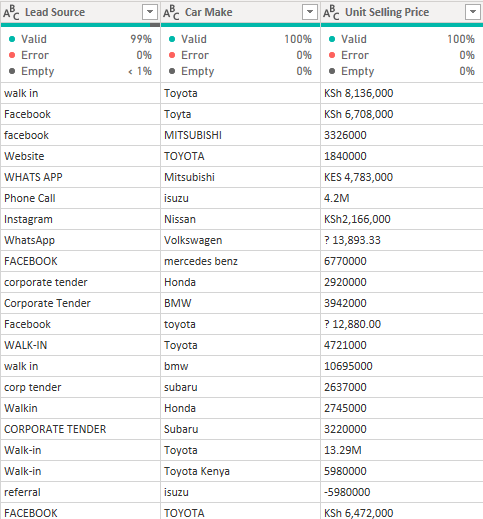

---

## 5. Currency Standardisation

**Reporting currency:** Kenya Shillings (KES). **Rule from the brief:** a value with no currency indicator is KES.

**Columns affected:** `Unit Selling Price`, `Unit Cost`, `Delivery Fee`, `Logistics Cost`, `Revenue Recorded`.

### Detection rules (applied to every monetary value)

| Pattern in the text | Currency assumed |
|---|---|
| `USD` or `$` | USD |
| `EUR` | EUR |
| `ZAR` or starts with `R ` | ZAR |
| `GBP` or `?` (the `?` is a corrupted pound sign) | GBP |
| `KES`, `KSh`, or no indicator | KES |
| Ends in `M` | multiply by 1,000,000 |

### Exchange rates used (one fixed set for the whole project)

| Currency | KES per 1 unit |
|---|---|
| KES | 1.00 |
| USD | 129.40 |
| EUR | 136.90 |
| ZAR | 7.33 |
| GBP | 181.00 |

**Source:** [name your source, e.g. Central Bank of Kenya indicative rates or XE.com] · **Date checked:** [date]

### Approach
A single `FX` table and a `fnMoney` function return the original amount, detected currency and KES amount for each value. One consistent rate set is used so all comparisons are on the same basis. The exact value of the rate matters less than applying it consistently and documenting it.

```m
fnMoney = (v as any) as record =>
    let
        t0 = Text.Upper(Text.Trim(Text.From(v) ?? "")),
        isBad = List.Contains({"","-","ERROR","#VALUE!","#ERROR","MISSING","NOT AVAILABLE","TBD","NULL","NOT SURE"}, t0),
        curr = if isBad then null
               else if Text.Contains(t0, "USD") or Text.Contains(t0, "$") then "USD"
               else if Text.Contains(t0, "EUR") then "EUR"
               else if Text.Contains(t0, "ZAR") or Text.StartsWith(t0, "R ") then "ZAR"
               else if Text.Contains(t0, "GBP") or Text.Contains(t0, "?") then "GBP"
               else "KES",
        /* ... strip symbols, apply M multiplier, look up rate ... */
    in
        [Amt = n, Curr = curr, AmtKES = if n = null then null else n * rate]
```

**Spot check:** `$ 37,184.62` on order `LCL1178` → 37,184.62 × 129.40 = **KES 4,811,690**.

**Assumption to note:** the `?` symbol is assumed to be a corrupted £ (GBP). Other currencies would change those few values; the assumption is applied consistently.

---

## 6. Data Cleaning and Transformation (Power Query)

The full script is in [`power_query/JCars_Cleaned.m`](power_query/JCars_Cleaned.m). The raw file is also kept as an untouched query for audit.

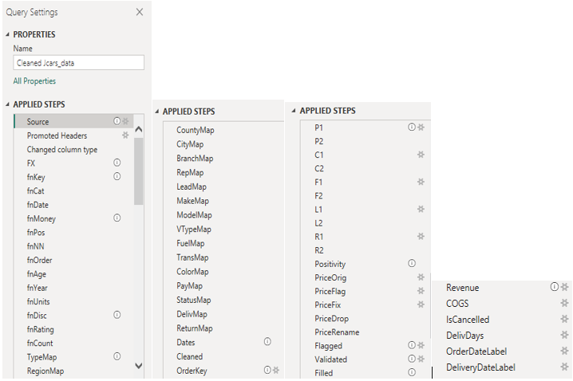

### Pipeline

1. **Import** with `QuoteStyle.Csv` and UTF-8; promote headers; load everything as text so nothing is mis-typed automatically.
2. **Standardise placeholders**: treat `-`, `NULL`, `N/A`, `missing` and similar as null.
3. **Parse dates** with `fnDate`: handles text formats (day-first tried before month-first), Excel serial numbers and invalid dates (returned as null and flagged).
4. **Standardise text categories** with `fnCat` and mapping tables for customer type, region, county, city, branch, sales rep, lead source, make, model, vehicle type, fuel, transmission, colour, payment method and payment and delivery status. `fnCat` trims, strips non-printing characters, matches on a lower-case alphanumeric key and falls back to proper case.
5. **Parse numerics** with dedicated functions (`fnUnits`, `fnDisc`, `fnRating`, `fnAge`, `fnYear`, `fnCount`) that handle number words and text formats.
6. **Create a surrogate key**: `Order Key` (index 1 to 276) because `Order ID` is not unique.
7. **Convert currency**: `fnMoney` returns KES values for the five monetary columns.
8. **Apply the price magnitude rule** (below).
9. **Flag** every row with a `Data Quality Flag` *before* any default is applied, so the evidence of the original problem survives.
10. **Validate**: compute `Revenue Variance KES` = computed − recorded.
11. **Apply documented defaults** to remaining nulls (see [section 8](#8-assumptions-and-business-rules)).
12. **Create business columns**: `Revenue KES`, `COGS KES`, `IsCancelled`, `Delivery Days`, date labels.

### Price magnitude rule
Two orders had unit prices roughly ten times any comparable vehicle and negative recorded revenue. The next-highest unit price in the entire dataset is about KES 16.5M, so a 20M threshold catches exactly these two and nothing else.

```m
PriceFlag = Table.AddColumn(PriceOrig, "Price Corrected", each
    if [Unit Selling Price KES] <> null and [Unit Selling Price KES] > 20000000
       and [Revenue Recorded KES] <> null and [Revenue Recorded KES] < 0
    then "Yes" else "No", type text),
PriceFix = Table.AddColumn(PriceFlag, "Unit Selling Price KES Fixed", each
    if [Price Corrected] = "Yes" then [Unit Selling Price KES] / 10
    else [Unit Selling Price KES], type number),
```

Requiring **both** conditions (very high price **and** negative recorded revenue) avoids altering a genuinely expensive order. The original value is kept in `Unit Selling Price KES (Original)` for audit.

| | Before correction | After correction |
|---|---|---|
| Total revenue (KES) | 1,643,879,121 | 1,419,369,621 |
| Gross profit margin | 24.30% | 12.33% |
| Average order value (KES) | 5.96M | 5.14M |

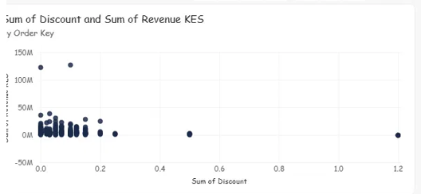

---

## 7. Data Validation

| Check | How | Result |
|---|---|---|
| No records lost | Total Orders card (distinct `Order Key`) vs source rows | **276 = 276** |
| Units preserved | Total Units Sold | **466** |
| Surrogate key unique | `DISTINCTCOUNT(Order Key)` = row count | Pass |
| Totals consistent across pages | Branch, rep and region totals vs Executive Dashboard | **KES 1,419,369,621 on every view** |
| Customer dimension | Distinct cleaned names (including `Unknown`) | **183** |
| Currency conversion | Manual recalculation of sample rows | e.g. USD 37,184.62 → KES 4,811,690 ✔ |
| Categories standardised | Distinct values per column after cleaning | [fill in: e.g. regions now 7, branches 8] |
| Recorded vs computed revenue | `Revenue Variance KES` by order | [fill in: N orders differ by more than 5%]; examples: `LCL1001` (computed 18.27M vs recorded 9.14M), `LCL1000` (sign flipped) |
| Outliers | Scatter of discount vs revenue, make margins | Two orders traced to magnitude errors and corrected |
| Before/after correction | Revenue and margin cards | See [section 6](#6-data-cleaning-and-transformation-power-query) |

**Discrepancies investigated, not silently resolved.** Where recorded and computed revenue disagree, both are kept, the gap is calculated and the order is flagged. Computed revenue (units × price × (1 − discount) + delivery fee) is the primary figure because every input to it is visible and checkable.

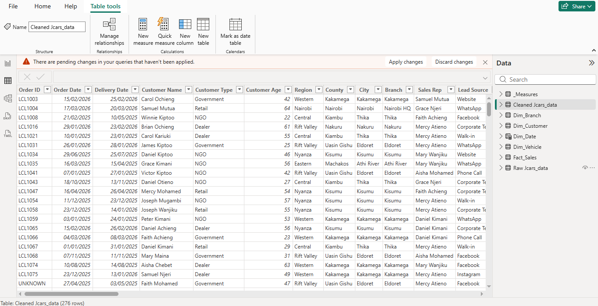

---

## 8. Assumptions and Business Rules

| Area | Rule |
|---|---|
| Currency | No indicator = KES. `?` = GBP (corrupted £). `R` = ZAR. One fixed rate table for the whole project. `M` suffix = millions |
| Revenue | `Revenue KES = Units Sold × Unit Selling Price KES × (1 − Discount) + Delivery Fee KES`. This is **booked (gross) revenue**: it includes cancelled, refunded and returned orders because the data does not say whether a return reverses revenue |
| Cost | `COGS KES = Units Sold × Unit Cost KES` |
| Gross profit | `Revenue − COGS`. Delivery fee income is included in revenue. **Logistics cost is reported separately and not deducted** from gross profit |
| Gross margin % | `Gross Profit ÷ Revenue` |
| Discount | Values ≥ 1 are percentage points (`20` = 20%); sign ignored; words converted; >30% flagged; extremes retained |
| Missing values | Age = 35, Vehicle Year = 2022, Units = 1, Discount = 0, Rating = 3, Review Count = 0, Delivery Fee, Logistics Cost, Unit Price and Unit Cost = 0. **Every default is flagged** in `Data Quality Flag`, and reported ratings exclude defaulted values |
| Dates | Order Date drives time analysis. Day-first is tried before month-first when ambiguous. 19 orders with no usable Order Date stay in all totals but are excluded from date-based visuals. Delivery Date has an inactive relationship used through `USERELATIONSHIP` |
| Order identity | `Order Key` (surrogate) is the key; `Order ID` is a display reference only |
| Customer | Identified by cleaned name. `Unknown` customers are excluded from customer rankings and segment analysis |
| Returned / Cancelled | Returned = `Yes` in the Returned column. Cancelled = Payment Status **or** Delivery Status is Cancelled |
| Customer segment | **Repeat** = more than one order under the same cleaned name; **One-time** = one order |
| Delivery performance | The data has no promised delivery date, so true on-time performance cannot be measured. "On-time delivery rate" is effectively the share of non-cancelled orders marked Delivered |
| Outlier handling | Correct only when a documented two-condition rule is met; otherwise flag and retain |
| Records removed | **None** |

---

## 9. Data Model

**Business process:** vehicle sales order lines. **Schema:** star.

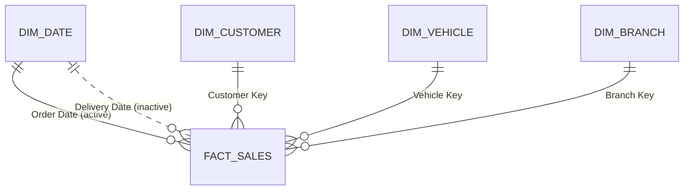

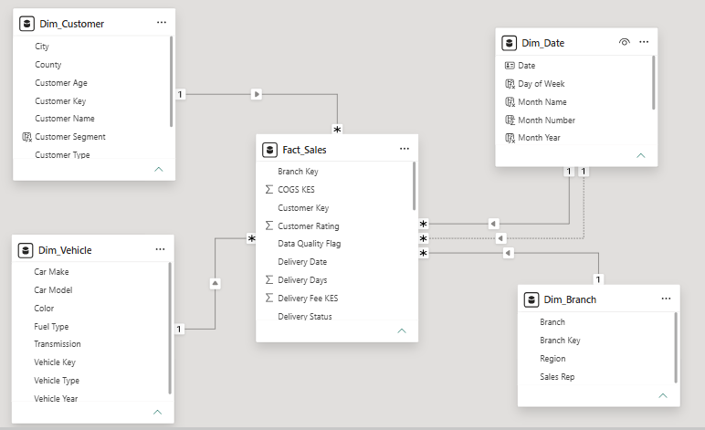

| Table | Type | Grain | Key | Main columns |
|---|---|---|---|---|
| `Fact_Sales` | Fact | One order line | `Order Key` | Dates, units, KES price, cost, discount, delivery fee, logistics cost, `Revenue KES`, `COGS KES`, recorded revenue, variance, payment and delivery status, rating, returned, cancelled flag, delivery days, quality flag, `Exception Reason` |
| `Dim_Customer` | Dimension | One cleaned customer name | `Customer Key` | Name, type, age, region, county, city, `Order Count`, `Customer Segment` |
| `Dim_Vehicle` | Dimension | Make + model + year | `Vehicle Key` | Make, model, vehicle type, year, fuel, transmission, colour |
| `Dim_Branch` | Dimension | Branch + sales rep | `Branch Key` | Branch, sales rep, region |
| `Dim_Date` | Dimension (marked as date table) | One calendar day | `Date` | Year, month number and name, month-year with sort column, quarter, day of week |

**Relationships:** every dimension → `Fact_Sales`, one-to-many, single-direction filtering. `Dim_Date[Date]` → `Fact_Sales[Order Date]` is active; `Dim_Date[Date]` → `Fact_Sales[Delivery Date]` is inactive.

**Why this design**
- One fact table at the order-line grain avoids duplicated measures.
- Single-direction one-to-many relationships keep filtering unambiguous.
- One shared date table with one active and one inactive relationship keeps slicers consistent; delivery-date analysis uses `USERELATIONSHIP` explicitly.
- The raw staging query is not loaded into the model.

---

## 10. DAX Measures

All measures live in a dedicated `_Measures` table. Each has an analytical purpose tied to a management question. Full list in [`dax/measures.dax`](dax/measures.dax).

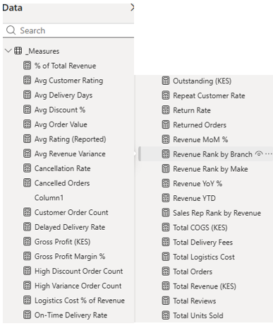

### Core performance
```DAX
Total Units Sold = SUM(Fact_Sales[Units Sold])
Total Orders = DISTINCTCOUNT(Fact_Sales[Order Key])
Total Revenue = SUM(Fact_Sales[Revenue KES])
Total COGS = SUM(Fact_Sales[COGS KES])
Gross Profit = [Total Revenue] - [Total COGS]
Gross Profit Margin % = DIVIDE([Gross Profit], [Total Revenue])
Avg Order Value = DIVIDE([Total Revenue], [Total Orders])
```

### Logistics, delivery, returns and cancellations
```DAX
Total Logistics Cost = SUM(Fact_Sales[Logistics Cost KES])
Logistics Cost % of Revenue = DIVIDE([Total Logistics Cost], [Total Revenue])
Avg Delivery Days = AVERAGE(Fact_Sales[Delivery Days])

Delayed Delivery Rate =
DIVIDE(CALCULATE(COUNTROWS(Fact_Sales), Fact_Sales[Delivery Status] = "Delayed"),
       COUNTROWS(Fact_Sales))

Returned Orders = CALCULATE(COUNTROWS(Fact_Sales), Fact_Sales[Returned] = "Yes")
Return Rate = DIVIDE([Returned Orders], COUNTROWS(Fact_Sales))
Cancelled Orders = CALCULATE(COUNTROWS(Fact_Sales), Fact_Sales[IsCancelled] = TRUE)
Cancellation Rate = DIVIDE([Cancelled Orders], COUNTROWS(Fact_Sales))
```

### Customer experience
```DAX
Avg Customer Rating = AVERAGE(Fact_Sales[Customer Rating])

Avg Rating (Reported) =
CALCULATE(AVERAGE(Fact_Sales[Customer Rating]),
          NOT CONTAINSSTRING(Fact_Sales[Data Quality Flag], "Rating invalid"))
```

### Rankings and contribution
```DAX
Revenue Rank by Branch = RANKX(ALL(Dim_Branch[Branch]), CALCULATE([Total Revenue]))
Sales Rep Rank by Revenue = RANKX(ALL(Dim_Branch[Sales Rep]), CALCULATE([Total Revenue]))

% of Total Revenue =
DIVIDE([Total Revenue],
       CALCULATE([Total Revenue], ALL(Fact_Sales), ALL(Dim_Vehicle), ALL(Dim_Branch), ALL(Dim_Customer)))
```

### Time intelligence (uses the marked date table)
```DAX
Revenue MoM % =
VAR Cur = [Total Revenue]
VAR Prev = CALCULATE([Total Revenue], DATEADD(Dim_Date[Date], -1, MONTH))
RETURN DIVIDE(Cur - Prev, Prev)

Revenue YoY % =
VAR Cur = [Total Revenue]
VAR Prev = CALCULATE([Total Revenue], SAMEPERIODLASTYEAR(Dim_Date[Date]))
RETURN DIVIDE(Cur - Prev, Prev)

Revenue YTD = TOTALYTD([Total Revenue], Dim_Date[Date])

Deliveries by Delivery Date =
CALCULATE(COUNTROWS(Fact_Sales),
          USERELATIONSHIP(Dim_Date[Date], Fact_Sales[Delivery Date]))
```

### Customer value
```DAX
Customer Lifetime Revenue =
CALCULATE([Total Revenue], ALLEXCEPT(Dim_Customer, Dim_Customer[Customer Key]))
```
Calculated columns on `Dim_Customer`:
```DAX
Order Count = CALCULATE(COUNTROWS(Fact_Sales))
Customer Segment =
IF(Dim_Customer[Customer Name] = "Unknown", "Unknown",
   IF(Dim_Customer[Order Count] > 1, "Repeat", "One-time"))
```

### Investigation
Calculated column on `Fact_Sales` and a measure that counts it:
```DAX
Exception Reason =
IF(Fact_Sales[Revenue Recorded KES] < 0, "Negative recorded revenue; ", "") &
IF(Fact_Sales[Revenue Recorded KES] > 0 &&
   ABS(Fact_Sales[Revenue Variance KES]) > 0.05 * Fact_Sales[Revenue Recorded KES],
   "Revenue mismatch >5%; ", "") &
IF(Fact_Sales[Discount] > 0.3, "Discount >30%; ", "") &
IF(Fact_Sales[Revenue KES] > 0 &&
   Fact_Sales[Logistics Cost KES] > 0.1 * Fact_Sales[Revenue KES],
   "Logistics >10% of revenue; ", "") &
IF(Fact_Sales[Delivery Days] < 0, "Delivered before ordered; ", "")

Exception Count = CALCULATE(COUNTROWS(Fact_Sales), Fact_Sales[Exception Reason] <> "")
```

---

## 11. Report Design

**Flow:** Executive Dashboard → detailed pages → drill-through to order level. A page navigator is on every page so a manager can move between views without using page tabs.

**Design system:** navy `#1B2A4A` (primary), teal `#2E8B8B` (secondary), green `#2E7D32` (good), amber `#E67E22` (attention), red `#C0392B` (problem), light grey background. One font family and a fixed set of text sizes. Currency shown as KES throughout, with consistent display units. Colours are set in a report theme so every visual inherits them.

### Page 1: Executive Dashboard
Answers *"How is JCars Logistics performing?"* in one screen.

- **Slicers:** Region, order date range, Branch
- **KPI cards:** Total Revenue, Gross Profit, Gross Profit Margin %, Total Units Sold, Avg Order Value, Repeat Customer Rate
- **Trend:** revenue by month (chronological, undated orders filtered out)
- **Comparisons:** revenue by branch, revenue by car make
- **Needs attention:** orders with the largest recorded-vs-computed revenue gaps

Deliberately left off: payment, logistics and customer-experience detail. That belongs on the detail pages.

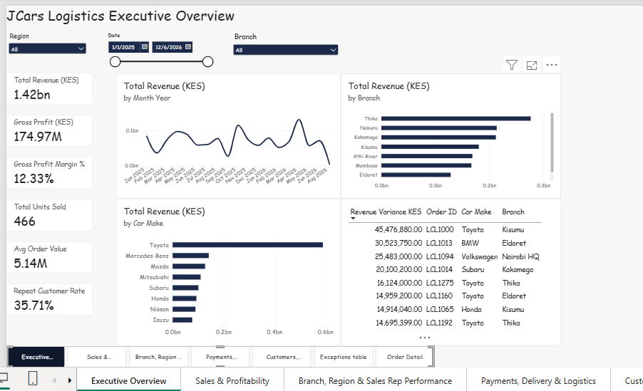

### Page 2: Sales and Vehicle Performance
Make → model matrix (revenue, units, margin), revenue by vehicle type, discount vs revenue scatter (one dot per order), vehicle-year slicer.


### Page 3: Branch, Region and Sales Rep Performance
Branch scorecard (revenue, units, margin, rating), revenue by region, sales rep leaderboard with ranks, lead source performance, customer-type slicer.


### Page 4: Payments, Delivery and Logistics
Logistics cost, logistics % of revenue, average delivery days and delay rate; payment status by value and by order count; payment method; delivery status; branch table of delivery days, delay rate and cancellation rate.


### Page 5: Customers, Returns and Investigation
Exception count, return rate, cancellation rate and reported rating; top 10 customers (Unknown excluded); returns and cancellations by make; rating vs revenue scatter; revenue by customer type; repeat vs one-time revenue.


### Page 6: Exceptions Table
Order-level list of flagged orders with the reason for each flag.

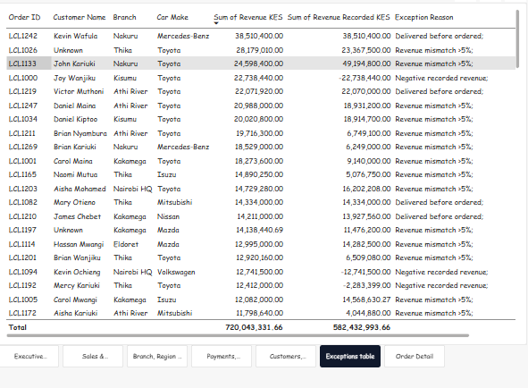

### Interactivity

| Feature | Implementation | Purpose |
|---|---|---|
| Slicers | Region, date range, branch, customer type, payment method, vehicle year | Let managers filter by the dimension they care about |
| Cross-filtering | Default visual interactions; KPI cards left stable | Click a branch or make to see everything for it |
| **Drill-through** | Hidden **Order Detail** page, drill-through fields `Branch` and `Customer Name` | From any branch or customer, jump to the underlying orders |
| **Report tooltip** | Hidden **Make Tooltip** page (model breakdown, margin, return rate) on car make visuals | Hover over a make to see its models without leaving the page |
| Navigation | Page navigator on every page | Move from overview to detail and back |

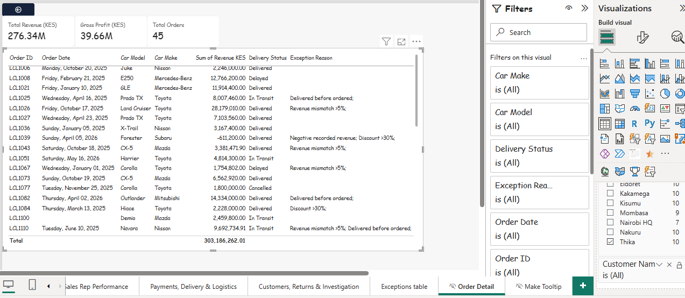
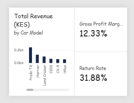

---

## 12. Analyst-Defined Business Questions

| # | Question | Why it matters | Where it is answered |
|---|---|---|---|
| 1 | Do repeat customers generate more revenue than one-time buyers? | Shows whether to invest in retention or acquisition | Page 5: repeat vs one-time segment |
| 2 | Which lead sources bring the most profitable business, not just the most revenue? | Marketing spend should follow margin | Page 3: lead source visual with margin |
| 3 | How much booked revenue is not yet fully paid? | Cash-flow exposure | Page 4: payment status by value |
| 4 | Do delayed deliveries receive lower customer ratings? | Tests whether logistics performance affects satisfaction | Page 4: delivery status vs reported rating |
| 5 | Which branches have unusually high cancellation or return rates relative to sales? | Points to where operations need review | Page 4 and Page 5 |

---

## 13. Investigation and Exceptions

An order is treated as an exception if it meets any of these evidence-based tests (all thresholds are documented and adjustable):

| Test | Reason |
|---|---|
| Negative recorded revenue | Impossible for a completed sale |
| Recorded vs computed revenue differ by more than 5% | Two sources disagree on the value of the same order |
| Discount above 30% | Well above the typical discount range in the data |
| Logistics cost above 10% of order revenue | Unusually expensive to deliver relative to value |
| Delivery date before order date | Impossible sequence |

Current result: [fill in: N of 276 orders flagged after threshold tuning].

Findings worth recording:

- **Two orders (`LC1192`, `LCL-1094`)** had unit prices about 10× any comparable vehicle and negative recorded revenue. Traced from two symptoms in the report: a pair of outlier dots on the discount scatter and Volkswagen's 79.5% margin. They were corrected by a documented rule and are visible through `Price Corrected`.
- **`CAR1070`** had no unit cost, which inflated the Volkswagen margin.
- **Negative recorded revenue** appears on several orders and always conflicts with the computed value.

---

## 14. Key Insights

Figures marked ≈ are read from chart labels; all others are calculated from the model.

**1. Two data-entry errors had hidden the real profitability.**
Two unit prices about 10× too high inflated reported revenue by about KES 225M (13.7%) and doubled the apparent margin, from 24.3% to 12.3%. After correction, total revenue is KES 1.42bn on 466 vehicles, with gross profit of ≈KES 175M. *Why it happened is unknown (entry error is the most likely explanation) and should be confirmed against source records.*

**2. Kakamega and Eldoret sell a lot but earn little.**
Together they account for 32% of units sold (150 of 466) and 24% of revenue, but only about 10% of gross profit (≈KES 17.6M of 175M). Their margins are 5.8% and 4.1% against a company average of 12.3%. Nairobi HQ earns 25.2% on only 5% of revenue, and Athi River earns 17.2%. *The data cannot say why. Discounting, vehicle mix and cost completeness at these branches should be checked.*

**3. The branches with the slowest deliveries also cancel the most.**
Nairobi HQ averages 26.3 days to deliver (company average: 15.2) and cancels 33% of orders (about 7 of 21). Kisumu averages 19.1 days and cancels 25.8% (about 8 of 31). The company-wide cancellation rate is 15.2%. *The samples are small and cancellation reasons are not recorded, so this points to a process review, not a conclusion.*

**4. Nearly a third of orders are returned.**
88 of 276 orders (31.9%) are marked returned and 42 (15.2%) cancelled, yet all of that sits inside the KES 1.42bn headline. Among makes with meaningful volume, Honda (13 of 34, 38%) and Mitsubishi (10 of 27, 37%) are highest; Toyota is 29 of 86 (34%). BMW's 56% rests on only 9 orders. *Whether a return reverses revenue is not stated in the data.*

**5. About 40% of booked value is not fully paid, and cash and M-Pesa carry half of it.**
Roughly KES 0.8bn of 1.42bn is fully paid; ≈KES 0.57bn is pending or partially paid. M-Pesa and cash together account for ≈49% of value (≈KES 0.70bn) on vehicles averaging KES 5.1M per order, which is unusual enough to validate with finance.

**6. Repeat customers are worth about 1.6× more per customer, but half of revenue comes from one-time buyers.**
The 65 named repeat customers generated KES 642M (47.6% of attributed revenue), about KES 9.9M each, versus about KES 6.0M for each of the 117 one-time buyers. 64% of named customers buy only once.

**7. Revenue is not dependent on a few customers or reps.**
The top 10 customers contribute about 19.5% of revenue, and the largest single customer about 2.7%. Corporate, NGO, Government and Dealer buyers together make up roughly four-fifths of revenue. The top three sales reps produce 39.5% of revenue. One rep (Peter Kiptoo) has the highest average order value (KES 7.0M) and the lowest average rating (3.05).

**8. Ratings show no clear link to revenue.**
Average ratings by make sit between 3.0 and 4.0 regardless of make size, so no relationship is visible. Nothing in the data shows that ratings drive sales or the reverse.

---

## 15. Recommendations

| # | Recommendation | Evidence |
|---|---|---|
| 1 | **Add validation at order entry and a monthly reconciliation.** Block unit prices outside a plausible range and negative recorded revenue, require a cost, and compare recorded revenue with units × price | Insight 1; recorded vs computed revenue gaps (e.g. `LCL1001`) |
| 2 | **Review pricing, discounting and cost data at Kakamega and Eldoret before pushing more volume there.** Study what Nairobi HQ and Athi River do differently | Insight 2 |
| 3 | **Run a root-cause review of order-to-delivery at Nairobi HQ and Kisumu, and start recording cancellation reasons** | Insight 3 |
| 4 | **Record return reasons and define whether a return reverses revenue.** Report net revenue (excluding cancelled and returned orders) beside gross revenue, starting with Honda, Mitsubishi and Toyota | Insight 4 |
| 5 | **Follow up pending and partially paid orders, and have finance check how cash and M-Pesa payments of this size are recorded** | Insight 5 |
| 6 | **Pilot a follow-up programme for one-time buyers and monitor the repeat rate.** The data shows repeat customers are worth more, but it cannot prove a programme would cause that | Insight 6 |

These recommendations describe what to investigate, change or monitor. They are not claims that the data proves cause.

---

## 16. Limitations

- **Customer identity** rests on cleaned names; typo variants may split one customer into two.
- **Default values** (age, vehicle year, units, rating, cost, logistics cost) are flagged but still influence averages and totals. Missing unit cost lowers COGS and flatters margin; missing logistics cost understates the 1.96% logistics-to-revenue ratio.
- **Gross revenue** includes cancelled, refunded and returned orders. A net revenue view needs a decision from the business.
- **True on-time delivery** cannot be measured without a promised delivery date.
- **Exchange rates** are one fixed set, not the rate on each order date.
- **Small samples** (e.g. BMW with 9 orders, Nairobi HQ with 21) make percentages volatile.
- The 20M price rule is a judgement supported by the data, not a confirmed fact about those orders.

---

## 17. Challenges and What I Learned

**Challenges**
- Column misalignment from quoted commas, which silently corrupts a CSV import if the quote style is wrong.
- A source ID that looked like a key but wasn't, which would have dropped real orders if I had de-duplicated on it.
- Mixed currencies and formats inside the same columns.
- Two outliers that distorted totals and margins and were only noticed through a scatter chart and one implausible make margin.
- Blank categories and alphabetical month ordering on the trend chart, fixed with a sort-by column and a visual filter.

**What I learned**
- Profile data before building anything; the model is only as good as the grain and the keys.
- Flag first, fill second, so the original problem remains traceable.
- Prefer a documented rule to a hand edit, and always keep the original value.
- Outliers are findings as well as problems: the discount scatter and a margin that looked too good to be true pointed straight at the data error.
- Design for the manager: summary on page one, detail behind it, and drill-through for the underlying records.

---

## 18. How to Open This Project

1. Clone or download the repository.
2. Open `JCars_Logistics.pbix` in Power BI Desktop.
3. If prompted, update the data source path to `data/Jcars_data.csv` (**Transform data → Data source settings**).
4. Refresh.

No credentials or personal data are stored in this repository.

---

*Questions or feedback are welcome. Connect with me on [LinkedIn](#) or read the [Dev.to article](#).*
